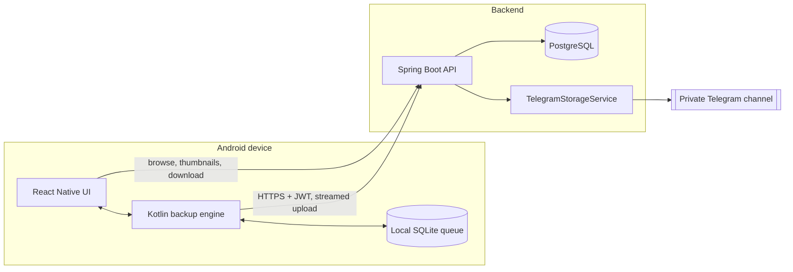

<div align="center">

# SyncAnything

**Snap it. Sync it. Keep it forever.**

Automatic, deduplicated photo and video backup for Android, backed by Telegram storage.


[Features](#features) | [Architecture](#architecture) | [Quick start](#quick-start) | [Telegram setup](#telegram-setup) | [API](#api) | [Security](#security-and-privacy) | [Status](#project-status) | [Roadmap](#roadmap)

</div>

---

## Why SyncAnything

Most gallery apps either lock your library behind a storage quota or back up unreliably. SyncAnything pairs a **Google Photos-style gallery** with a **backup engine built to survive real conditions**: app kills, reboots, flaky networks, and duplicate files.

- **Set and forget:** new photos and videos are detected and queued automatically.
- **Honest status:** an item is marked *backed up* only after the backend confirms storage. No fake progress bars.
- **No wasted uploads:** SHA-256 deduplication on the device and on the server.
- **You own the pipeline:** self-hosted backend, your private Telegram destination, your database.

---

## Features

### Backup engine (native Kotlin)

- MediaStore scanning for existing media and `ContentObserver` for new media (no full-device rescans).
- Persistent queue with states: `DISCOVERED`, `QUEUED`, `WAITING_FOR_NETWORK`, `UPLOADING`, `VERIFYING`, `BACKED_UP`, `RETRY_PENDING`, `FAILED`, `SKIPPED`, `MISSING_SOURCE`.
- Foreground service for visible uploads, WorkManager for constraint-aware scheduling, boot receiver for recovery after restart.
- Exponential backoff with jitter. Transient and permanent failures are handled differently.
- Idempotency keys, queue ownership, and stale `UPLOADING` recovery to prevent double uploads and false success states.
- Streaming uploads with bounded memory, so large videos never load fully into RAM.
- Hash caching, invalidated when the source file changes.

### Controls

- Wi-Fi only (default), Wi-Fi plus mobile data, charging-only, optional large-video limits.
- Folder inclusion and exclusion, manual backup, pause and resume, retry one or retry all.
- When a restriction is not met, the file **stays queued**. It is never marked failed.

### Gallery (React Native + TypeScript)

- Dark-mode-first timeline grouped by day, month, and year, with infinite scroll and multi-select.
- Full-screen viewer: swipe, pinch-zoom, video playback, favorites, details, share.
- Albums: create, rename, add and remove media. Deleting an album does not delete its media.
- Search by filename, date, media type, album, favorites, and backup state.
- Backup dashboard and upload queue with real counts, real progress, and readable errors.
- Local, cloud, and both-location indicators on every item.

### Restore and safe deletion

- Preview-first browsing with thumbnails. Originals download on demand, streamed.
- Restore to a new device after login, duplicate-aware.
- Deleting a local file **never** deletes the cloud copy by default. Cloud trash, restore, and permanent delete are separate, explicit actions.

### Backend (Spring Boot)

- JWT access tokens, rotating refresh tokens stored as hashes, logout and revocation, rate limiting.
- Per-user ownership enforced on every query. Client-supplied IDs and status are never trusted.
- Server-side idempotency and reconciliation for the case where the Telegram upload succeeds but the database write fails.
- Flyway migrations, Bean Validation, OpenAPI docs, structured logs with correlation IDs.

---

## Architecture



| Layer    | Stack                                                            |
|----------|------------------------------------------------------------------|
| Mobile   | React Native, TypeScript (strict), native Kotlin modules         |
| Backend  | Java 21, Spring Boot 3, Spring Security, Spring Data JPA, Flyway |
| Database | PostgreSQL                                                       |
| Storage  | Private Telegram destination behind a `TelegramStorageService`   |
| Ops      | Docker, Docker Compose, OpenAPI                                  |

**Key rule:** Telegram credentials live only on the server. The app never holds a bot token, API hash, or signing key.

### Repository layout

```text
SyncAnything/
|-- mobile/                  React Native app
|   |-- src/                 screens, components, state, API client
|   `-- android/             Kotlin modules, services, receivers, Gradle config
|-- backend/                 Spring Boot application
|   `-- src/main/
|       |-- java/            controllers, services, domain, repositories, security, telegram
|       `-- resources/db/migration/   Flyway migrations
|-- docker-compose.yml
|-- .env.example             placeholders only
`-- README.md
```

---

## Quick start

### Prerequisites

| Tool        | Version                                  |
|-------------|------------------------------------------|
| JDK         | 21                                       |
| Node.js     | 20 LTS or newer                          |
| Android SDK | API 34 or newer, plus emulator or device |
| Docker      | For PostgreSQL and the backend container |

### 1. Configure the environment

```bash
cp .env.example .env
```

Fill in the database credentials, a JWT secret, the Telegram bot token, and the Telegram channel ID. Generate a strong secret with:

```bash
openssl rand -base64 48
```

Never commit `.env`.

### 2. Start PostgreSQL and the backend

```bash
docker compose up -d postgres
cd backend
./gradlew bootRun
```

Use `./mvnw spring-boot:run` instead if the backend uses Maven.

- Health check: `http://localhost:8080/actuator/health`
- API docs: `http://localhost:8080/swagger-ui.html`

### 3. Run the Android app

```bash
cd mobile
npm install
npx react-native run-android
```

On first launch, enter your backend URL, register, and grant the media permissions.

> Android emulator note: the emulator reaches your computer at `http://10.0.2.2:8080`, not `localhost`.

### 4. Run the tests

```bash
# Backend
cd backend && ./gradlew test

# Mobile: type check and unit tests
cd mobile && npm run typecheck && npm test

# Android native unit tests
cd mobile/android && ./gradlew testDebugUnitTest
```

### 5. Build a debug APK

```bash
cd mobile/android
./gradlew assembleDebug
```

Output: `mobile/android/app/build/outputs/apk/debug/app-debug.apk`

For release builds, create your own signing key and keep it out of Git.

---

## Telegram setup

1. Create a bot with [@BotFather](https://t.me/BotFather) and copy the token.
2. Create a **private** channel and add the bot as an **administrator** with permission to post messages.
3. Find the channel ID and set it in `.env`.
4. Start the backend and call `GET /api/v1/storage/health`. It reports missing permissions, an inaccessible channel, or invalid credentials explicitly.

> **File-size limits depend on the Telegram method used.** The standard Bot API and a self-hosted Bot API server have different upload and download limits. Check Telegram's current documentation before relying on large files. SyncAnything is designed to fail with a clear error if a file exceeds what the configured method supports, rather than pretend it worked.

---

## API

Versioned REST under `/api/v1`. Full reference is served by Swagger UI.

| Area    | Endpoints                                                                           |
|---------|-------------------------------------------------------------------------------------|
| Auth    | `POST /auth/register`, `POST /auth/login`, `POST /auth/refresh`, `POST /auth/logout` |
| Media   | `GET /media`, `GET /media/{id}`, `POST /media/uploads`, `GET /media/{id}/download`   |
| Trash   | `DELETE /media/{id}`, `POST /media/{id}/restore`                                     |
| Albums  | `GET /albums`, `POST /albums`, `PATCH /albums/{id}`, `DELETE /albums/{id}`           |
| Album media | `POST /albums/{id}/media`, `DELETE /albums/{id}/media/{mediaId}`                 |
| Backup  | `GET /backup/status`, `GET /backup/queue`, `POST /backup/retry`                      |
| Storage | `GET /storage/health`                                                                |

- Uploads carry an `Idempotency-Key` header. Retrying with the same key never creates a duplicate.
- List endpoints are paginated.
- Errors return a stable code and a sanitized message.

---

## Security and privacy

- Passwords are hashed with an adaptive algorithm. Refresh tokens are stored only as hashes and rotated on use.
- Access tokens are short-lived. Mobile tokens use Android Keystore-backed storage.
- Rate limiting on auth endpoints, restricted CORS, input validation, safe error responses.
- Logs never contain tokens, secrets, or complete media URLs. Filenames and GPS data are not logged.
- HTTPS is required in production.

> **Telegram storage is not end-to-end encrypted.** Anyone with access to the Telegram destination, and the operator of your backend, can access stored media. Protect the channel and the server like the keys to your photo library.

---

## Android background execution

Android can stop background work on aggressive battery-saver devices. SyncAnything uses a foreground service and WorkManager to recover, but it cannot guarantee uninterrupted execution on every manufacturer's build. If uploads pause unexpectedly, exempt the app from battery optimization in system settings.

---

## Project status

Update this table as features are built and verified.

| Area                                   | Status      |
|----------------------------------------|-------------|
| Auth, media API, Telegram adapter      | In progress |
| Native media discovery and queue       | In progress |
| Gallery UI, albums, search             | In progress |
| Restore, trash, dashboard              | Planned     |
| End-to-end validation on a real device | Planned     |

---

## Roadmap

- [ ] Resumable chunked uploads for very large videos
- [ ] Optional client-side encryption before upload
- [ ] Map view for geotagged media
- [ ] Shared albums
- [ ] iOS client
- [ ] Optional on-device OCR and semantic search, with a privacy review

---

## Contributing

1. Fork the repo and create a branch: `git checkout -b feat/my-change`
2. Keep the build and tests green.
3. Open a pull request describing the change and how you tested it.

Please report security issues privately, not through public issues.

---

## License

MIT. SyncAnything is an independent project and is not affiliated with Google or Telegram.
