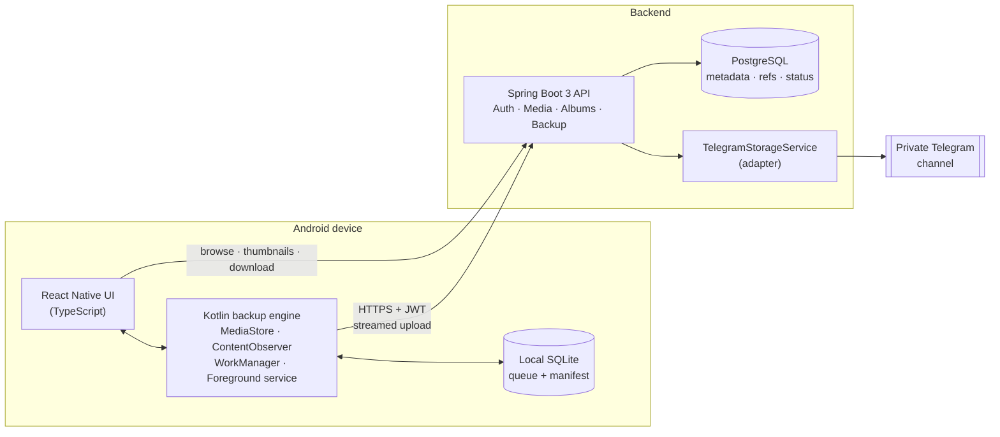

<div align="center">

<!-- Replace with your logo: docs/assets/logo.png -->


# SyncAnything

**Snap it. Sync it. Keep it forever.**
Automatic, deduplicated photo and video backup for Android, backed by Telegram storage.

[](https://github.com/YOUR_USERNAME/SyncAnything/actions)
[](https://github.com/YOUR_USERNAME/SyncAnything/actions)


[Features](#-features) · [Architecture](#-architecture) · [Quick start](#-quick-start) · [Telegram setup](#-telegram-setup) · [API](#-api) · [Security](#-security-and-privacy) · [Roadmap](#-roadmap)

</div>

<!-- Add a hero screenshot or GIF here. Screenshots matter more than any text. -->
<p align="center">
  
</p>

---

## Why SyncAnything

Gallery apps either lock your library behind a storage quota or back up unreliably. SyncAnything gives you a **Google Photos-style gallery** on top of a **backup engine built to survive the real world**: app kills, reboots, flaky networks, and duplicate files.

- **Set and forget.** New photos and videos are detected and queued automatically.
- **Honest status.** An item is marked *backed up* only after the backend confirms storage. No fake progress bars.
- **No wasted uploads.** SHA-256 deduplication on the device and on the server.
- **You own the pipeline.** Self-hosted backend, your private Telegram destination, your database.

---

## ✨ Features

### Backup engine (native Kotlin)
- MediaStore scanning for existing media and `ContentObserver` for new media. No full-device rescans.
- Persistent queue with states: `DISCOVERED → QUEUED → UPLOADING → VERIFYING → BACKED_UP`, plus `WAITING_FOR_NETWORK`, `RETRY_PENDING`, `FAILED`, `SKIPPED`, `MISSING_SOURCE`.
- Foreground service for visible, ongoing uploads. WorkManager for constraint-aware scheduling. Boot receiver for recovery after restart.
- Exponential backoff with jitter. Transient and permanent failures handled differently.
- Idempotency keys, queue ownership, and stale `UPLOADING` recovery to prevent double uploads and false success states.
- Streaming uploads with bounded memory, so large videos never load fully into RAM.
- Cached hashes, invalidated when the source file changes.

### Controls
- Wi-Fi only (default), Wi-Fi + mobile data, charging-only, optional large-video limits.
- Folder inclusion and exclusion, manual backup, pause and resume, retry one or retry all.
- Restrictions not met means the file **stays queued**. It is never marked failed.

### Gallery (React Native + TypeScript)
- Dark-mode-first timeline grouped by day, month, and year, with infinite scroll and multi-select.
- Full-screen viewer with swipe, pinch-zoom, video playback, favorites, details, and share.
- Albums: create, rename, add and remove media, delete an album without deleting its media.
- Search by filename, date, media type, album, favorites, and backup state.
- Backup dashboard and upload queue showing real counts, real progress, and readable errors.
- Local, cloud, and both-location indicators on every item.

### Restore and safe deletion
- Preview-first browsing with thumbnails. Originals download on demand, streamed.
- Restore to a new device after login, duplicate-aware.
- Deleting a local file **never** deletes the cloud copy by default. Cloud trash, restore, and permanent delete are separate, explicit actions.

### Backend (Spring Boot)
- JWT access tokens, rotating refresh tokens stored as hashes, logout and revocation, rate limiting.
- Per-user ownership enforced on every query. Client-supplied IDs and status are never trusted.
- Server-side idempotency and reconciliation for the "Telegram upload succeeded but the database write failed" case.
- Flyway migrations, Bean Validation, OpenAPI docs, structured logs with correlation IDs.

---

## 🏗 Architecture



| Layer    | Stack                                                                |
|----------|----------------------------------------------------------------------|
| Mobile   | React Native, TypeScript (strict), native Kotlin modules             |
| Backend  | Java 21, Spring Boot 3, Spring Security, Spring Data JPA, Flyway     |
| Database | PostgreSQL                                                           |
| Storage  | Private Telegram destination behind a `TelegramStorageService`       |
| Ops      | Docker, Docker Compose, OpenAPI                                      |

**Key design rule:** Telegram credentials live only on the server. The app never sees a bot token, API hash, or signing key.

### Repository layout

```
SyncAnything/
├── mobile/                 # React Native app
│   ├── src/                # screens, components, state, API client
│   └── android/            # Kotlin modules, services, receivers, Gradle config
├── backend/                # Spring Boot application
│   └── src/
│       ├── main/java/…     # controllers, services, domain, repositories, security, telegram
│       └── main/resources/db/migration/   # Flyway migrations
├── docs/                   # setup, Telegram, API, deployment, security, troubleshooting
├── docker-compose.yml
├── .env.example            # placeholders only
└── README.md
```

---

## 🚀 Quick start

### Prerequisites

| Tool            | Version           |
|-----------------|-------------------|
| JDK             | 21                |
| Node.js         | 20 LTS or newer   |
| Android SDK     | API 34+ (and an emulator or physical device) |
| Docker          | For PostgreSQL and the backend container |

### 1. Configure the environment

```bash
cp .env.example .env
# Fill in: DB credentials, JWT secret, Telegram bot token, Telegram channel ID
```

Never commit `.env`. Generate a strong JWT secret, for example `openssl rand -base64 48`.

### 2. Start the backend

```bash
docker compose up -d postgres
cd backend
./gradlew bootRun        # or: ./mvnw spring-boot:run
```

OpenAPI docs: `http://localhost:8080/swagger-ui.html`

### 3. Run the Android app

```bash
cd mobile
npm install
npx react-native run-android
```

On first launch, point the app at your backend URL, register, and grant media permissions.

### 4. Run the tests

```bash
cd backend && ./gradlew test
cd mobile  && npm run typecheck && npm test
cd mobile/android && ./gradlew testDebugUnitTest
```

### 5. Build a debug APK

```bash
cd mobile/android
./gradlew assembleDebug
# Output: app/build/outputs/apk/debug/app-debug.apk
```

Release signing and AAB instructions are in [`docs/DEPLOYMENT.md`](docs/DEPLOYMENT.md). Signing keys are never committed.

---

## 🤖 Telegram setup

1. Create a bot with [@BotFather](https://t.me/BotFather) and copy the token.
2. Create a **private** channel and add the bot as an **administrator** with permission to post messages.
3. Get the channel ID and set it in `.env`.
4. Start the backend and call `GET /api/v1/storage/health`. It reports missing permissions, an inaccessible channel, or invalid credentials explicitly.

> **File-size limits depend on the Telegram method you use.** The standard Bot API and a self-hosted Bot API server have different upload and download limits. SyncAnything validates the configured method at startup and fails with a clear error rather than pretending a large upload worked. See [`docs/TELEGRAM.md`](docs/TELEGRAM.md) for the current limits, the operational requirements, and how to configure a local Bot API server.

---

## 🔌 API

Versioned REST under `/api/v1`. Full reference via OpenAPI.

| Area    | Endpoints                                                                              |
|---------|----------------------------------------------------------------------------------------|
| Auth    | `POST /auth/register` · `/auth/login` · `/auth/refresh` · `/auth/logout`               |
| Media   | `GET /media` · `GET /media/{id}` · `POST /media/uploads` · `GET /media/{id}/download`  |
| Trash   | `DELETE /media/{id}` · `POST /media/{id}/restore`                                      |
| Albums  | `GET/POST /albums` · `PATCH/DELETE /albums/{id}` · `POST/DELETE /albums/{id}/media`    |
| Backup  | `GET /backup/status` · `GET /backup/queue` · `POST /backup/retry`                      |
| Storage | `GET /storage/health`                                                                  |

Uploads carry an `Idempotency-Key` header. Retrying with the same key never creates a duplicate. Lists use cursor or page-based pagination. Errors return a stable code and a sanitized message.

---

## 🔒 Security and privacy

- Passwords hashed with a modern adaptive algorithm. Refresh tokens stored only as hashes and rotated on use.
- Access tokens are short-lived. Mobile tokens are stored through Android Keystore-backed storage.
- Rate limiting on auth endpoints, restricted CORS, input validation, safe error responses.
- Logs never contain tokens, secrets, or complete media URLs. Filenames and GPS data are not logged.
- HTTPS is required in production.

> ⚠️ **Telegram storage is not end-to-end encrypted.** Anyone with access to the Telegram destination, and the operator of your backend, can access stored media. Treat the channel and the server like the keys to your photo library. Details in [`docs/SECURITY.md`](docs/SECURITY.md).

---

## 📊 Project status

> Keep this table honest. Update it as features are built and verified.

| Area                                   | Status |
|----------------------------------------|--------|
| Auth, media API, Telegram adapter      | 🚧 In progress |
| Native media discovery and queue       | 🚧 In progress |
| Gallery UI, albums, search             | 🚧 In progress |
| Restore, trash, dashboard              | 📝 Planned |
| End-to-end validation on a real device | 📝 Planned |

Verified behavior and known gaps are tracked in [`docs/KNOWN_LIMITATIONS.md`](docs/KNOWN_LIMITATIONS.md).

---

## ⚙️ Android background execution

Android can stop background work on aggressive battery-saver devices. SyncAnything uses a foreground service and WorkManager to recover, but it cannot guarantee uninterrupted execution on every OEM. If uploads pause unexpectedly, exempt the app from battery optimization. Per-vendor steps are in [`docs/TROUBLESHOOTING.md`](docs/TROUBLESHOOTING.md).

---

## 🗺 Roadmap

- [ ] Resumable chunked uploads for very large videos
- [ ] Optional client-side encryption before upload
- [ ] Map view for geotagged media
- [ ] Shared albums
- [ ] iOS client
- [ ] Optional on-device OCR and semantic search (with privacy review)

---

## 🤝 Contributing

1. Fork the repo and create a branch: `git checkout -b feat/my-change`
2. Keep the build and tests green: backend `./gradlew test`, mobile `npm run typecheck && npm test`
3. Open a pull request describing the change and how you tested it

Please read [`CONTRIBUTING.md`](CONTRIBUTING.md) and [`SECURITY.md`](SECURITY.md) before reporting vulnerabilities. Do not open public issues for security bugs.

---

## 📄 License

Released under the [MIT License](LICENSE).

SyncAnything is an independent project. It is not affiliated with, endorsed by, or sponsored by Google or Telegram.

<div align="center">

**If SyncAnything helps you, give it a ⭐**

</div>
